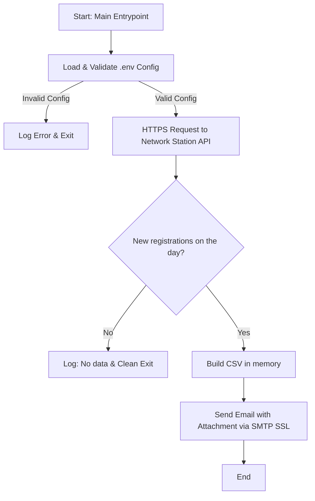
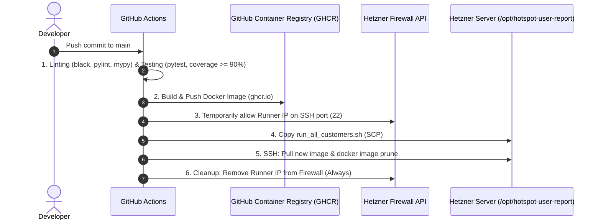

# Hotspot User Report

Automated service that retrieves, processes and emails a daily report of the users registered on Wi-Fi Hotspot gateways, through the **Network Station** API.

---

## Table of Contents

* [Overview and Architecture](#overview-and-architecture)
* [Project Structure](#project-structure)
* [Configuration and Environment Variables](#configuration-and-environment-variables)
* [Production Environment and Multi-tenant Deployment](#production-environment-and-multi-tenant-deployment)
* [CI/CD Pipeline and Automation](#cicd-pipeline-and-automation)
* [Local Development and Testing](#local-development-and-testing)

---

## Overview and Architecture

The application is written in Python 3.14 and runs inside a lightweight Docker container based on Alpine Linux.

### Execution Flow

1. **Startup and Validation (`main.py` / `config.py`)**: The application loads and strictly validates every required environment variable. If a value is missing or invalid, the run stops and reports every error found.
2. **Data Retrieval (`network_station.py`)**: The application calls the Network Station HTTPS endpoint to fetch the users registered on the report date. The date comes from the `--date` flag; without it, today is used. In production the orchestrator script decides it (see *Report Date*). If there are no new registrations, the run ends cleanly without sending anything.
3. **CSV Generation (`exporter.py`)**: The records are rendered as a `.csv` document **entirely in memory**, encoded as UTF-8 with a BOM so the spreadsheet that opens it does not have to guess the encoding, and named `report_utenti_<YYYY-MM-DD>.csv`. The columns are, in order, `Email`, `Nome`, `Cognome`, `Telefono`, `Lingua`. Cells starting with `=`, `+`, `-` or `@` get a leading apostrophe, so the spreadsheet treats them as text rather than formulas (*CSV injection*): users type this data themselves into the captive portal. The file is never written to disk: it exists only to be attached to the email, and keeping it would pile up personal data with no consumer and no retention policy.
4. **Email Delivery (`message.py` / `mailer.py`)**: The subject and body are defined in `message.py`, separate from the transport. `mailer.py` opens a secure connection to the SMTP server over implicit TLS (`SMTP_SSL`) and sends the email with the CSV report attached.



### Exit Codes

| Code | Meaning |
| --- | --- |
| `0` | Report sent, or no registrations on the day (no email). |
| `1` | Failure: invalid configuration, API or SMTP unreachable, unexpected error. The log states the reason. |
| `2` | Invalid arguments, for example a malformed or future `--date`. |
| `143` | Process terminated by `SIGTERM`, for example by the orchestrator script's `timeout`. |

---

## Project Structure

```text
.
├── .github/workflows/
│   └── deploy.yaml           # GitHub Actions CI/CD pipeline
├── src/
│   └── hotspot_user_report/
│       ├── __init__.py
│       ├── app.py             # Main workflow orchestration
│       ├── config.py          # Configuration loading and validation
│       ├── errors.py          # Base exception for anticipated failures
│       ├── exporter.py        # In-memory CSV report generation
│       ├── mailer.py          # SMTP SSL client and email delivery
│       ├── message.py         # Report email subject and body
│       ├── main.py            # Entrypoint, --date parsing and error handling
│       ├── models.py          # Domain models (HotspotUser, ReportEmail)
│       └── network_station.py # HTTP client for the Network Station API
├── tests/
│   ├── integration/           # Integration tests (`integration` marker)
│   └── test_*.py              # Unit tests (pytest)
├── .dockerignore              # Files excluded from the image build context
├── .env.example               # Template of the required environment variables
├── .python-version            # Python version used by uv locally
├── Dockerfile                 # Multi-stage Dockerfile based on Alpine Linux
├── docker-compose.yaml        # Docker setup for local development
├── pyproject.toml             # Project definition, dependencies and tool config
├── run_all_customers.sh       # Multi-tenant runner script for the server
└── uv.lock                    # Lockfile for reproducible dependency installs
```

---

## Configuration and Environment Variables

The application reads its configuration from the process environment, or from a `.env` file through `python-dotenv`.

### Required Variables (`.env.example`)

| Variable | Description |
| --- | --- |
| `NETWORK_STATION_HOST` | Network Station gateway hostname (without the `https://` scheme). |
| `NETWORK_STATION_API_KEY` | API Key for the Network Station API. |
| `NETWORK_STATION_API_SECRET` | API Secret. |
| `NETWORK_STATION_DOMAIN_ID` | Numeric ID of the domain to report on. |
| `SMTP_SERVER` | SMTP server used to send the report. |
| `SMTP_PORT` | SMTP server port (implicit TLS, e.g. `465`). |
| `SMTP_USER` | SMTP username / sender address. |
| `SMTP_PASSWORD` | SMTP password. |
| `EMAIL_TO` | Report recipient address. |

### Getting Network Station API Credentials

To connect the application to a reseller on Network Station, create a dedicated API user:

1. Log in to the **Network Station** admin panel.
2. In the **Treeview**, find the reseller.
3. Open the context menu (right click or properties button) and, in the **Admin** group, select **System users**.
4. Create a new API user, or open the menu of an existing one, to get:
   * `API Key`
   * `API Secret`

> **Note**: These credentials go into the customer's `.env` file on the production server (`/opt/hotspot-user-report/customers/<customer-a>.env`).

---

## Production Environment and Multi-tenant Deployment

Production runs on a **Hetzner** server and is **multi-tenant**: each customer has its own isolated configuration.

### First Server Setup

Prerequisites: Docker, `cron`, `logrotate`, `curl` and `timeout` (coreutils). Cron and deploy share the same non-root user, `deploy` (the value of `HETZNER_USER`), which must belong to the `docker` group and own `/opt/hotspot-user-report/`.

1. Create the base directory and the customers folder:

   ```bash
   sudo mkdir -p /opt/hotspot-user-report/customers
   sudo chown -R deploy:deploy /opt/hotspot-user-report
   chmod 700 /opt/hotspot-user-report/customers
   ```

2. Create `common.env`, one `customers/<customer-name>.env` per customer, and `healthcheck.env`, with mode `600` (see *Production `.env` Files*).
3. Configure the repository secrets (see [GitHub Actions Secrets](#github-actions-secrets)) and run the pipeline on `main`. The first deploy copies `run_all_customers.sh` and pulls the image: until it has run, neither exists on the server.
4. Install the `logrotate` configuration (see [Log Management and Rotation](#log-management-and-rotation-logrotate)).
5. Add the cron rule with `crontab -e` (see [Cron Schedule](#cron-schedule)).
6. Create the check on healthchecks.io (see [Check Configuration](#check-configuration)) and copy its URL into `healthcheck.env`.

### Server Directory Layout (`/opt/hotspot-user-report/`)

```text
/opt/hotspot-user-report/
├── common.env                   # Shared settings and SMTP credentials
├── healthcheck.env              # Monitoring ping URL (a credential)
├── customers/                   # Per-customer configuration
│   ├── customer-a.env
│   └── customer-b.env
├── logs/                        # Per-customer run logs
│   ├── customer-a.log
│   └── customer-b.log
└── run_all_customers.sh         # Runner script
```

### Production `.env` Files

* **`common.env`**: Configuration shared by every tenant (Network Station host, SMTP server credentials).
* **`customers/<customer-name>.env`**: Only the variables specific to one customer (Network Station API Key/Secret, Domain ID, email recipient).
* **`healthcheck.env`**: Holds only `HEALTHCHECK_URL`, read **by the script** and not by the container. Treat it as a credential: anyone holding that URL can send a fake success signal and silence the alerts. That is why it is not versioned in the repository and must be created by hand on the server.
* **Permissions**: Every `.env` file holds credentials in plain text. Make them readable only by the user that runs cron (`chmod 600`, and `chmod 700` on the `customers/` directory).
* **Onboarding a new customer**: Create the matching `.env` file in `/opt/hotspot-user-report/customers/`, with no change to code or script. Customers run in sequence and each may take up to 120 seconds, so the run length grows with their number while the healthchecks *grace time* stays fixed. The current 30-minute grace covers up to fourteen customers; past that it must be raised (see [Check Configuration](#check-configuration)).

### Runner Script (`run_all_customers.sh`)

The production run is driven by `run_all_customers.sh`:

* **Docker isolation**: Runs a dedicated container for each `.env` file found in `customers/`.
* **No data persistence**: The report is built in memory and sent as an attachment. No volume is mounted, and no customer personal data stays on the server.
* **Hardening and security**:
  * `--read-only`: The container filesystem is mounted read-only to prevent tampering.
  * `--tmpfs /tmp`: Keeps temporary files in RAM, never on disk.
  * `--memory=256m --cpus=0.5`: Strict memory and CPU limits, so a runaway run cannot starve the host.
* **Report date**: The script computes the date once, at startup, with `TZ=Europe/Rome date +%F`, and passes it to every container with `--date`. If each container read its own clock, a slow first customer could push the next one past midnight: its report would cover a day that has not started yet, empty, and the run would exit `0` with no signal at all. The time zone is named explicitly because the API server reads the query window as a `Europe/Rome` day; the `Dockerfile` pins the same zone for the container, and the two declarations must change together. The computed day is the closing one only as long as cron fires **before midnight**.
* **Maximum duration**: Each customer is wrapped in a 120-second `timeout`. A stuck run is stopped and marked as failed, instead of outliving the night and making every later run fail on the container name clash. The value sits below the healthchecks *grace time*, so the alert names **which** customer is stuck instead of only noting the silence. It is also the upper bound the application's own timeouts must fit in, the API calls and the SMTP wait: `tests/test_budget.py` adds up their worst case and compares it with the 120 seconds, which it reads straight from this script.
* **Clean termination (`--init`)**: Covers the window before `main()` registers its `SIGTERM` handler. The kernel does not apply default signal actions to PID 1, so an application without its own handler ignores `SIGTERM`, outlives the script while holding its `--name`, and makes every later night fail on the name clash. With `--init`, PID 1 is `tini`, which forwards the signal to the application: no longer PID 1, it gets the default action and terminates. Measured on the production base image: 10.2 seconds and exit 137 as PID 1 with no handler, 0.1 seconds and exit 143 in every other case. `tini` also reaps any zombie processes left by the run.
* **Logging**: Appends (`>>`) stdout and stderr to a single file per customer (`/opt/hotspot-user-report/logs/<customer-name>.log`). Rotation, compression and retention are left to the system `logrotate` daemon.
* <a id="cron-schedule"></a>**Cron schedule**: The script runs daily from crontab with this rule:

```cron
59 23 * * * mkdir -p /opt/hotspot-user-report/logs && /opt/hotspot-user-report/run_all_customers.sh >> /opt/hotspot-user-report/logs/cron.log 2>&1
```

### Regenerating a Past Report (`--date`)

The nightly run produces the report for the day that is closing. If that night fails (SMTP server rejection, API unreachable, container not started), the report **exists nowhere**: it is not saved to disk, neither on the server nor in the container, for the reasons given in *No data persistence*. The only way to recover it is to request it explicitly.

The application accepts a `--date` flag in ISO format (`YYYY-MM-DD`). Without it, today is used. A malformed or future date is rejected with exit code `2`, before any connection is opened. The nightly run uses the same flag, with the date computed by the script (see *Report date*).

```bash
docker run --rm --init \
  --env-file /opt/hotspot-user-report/common.env \
  --env-file /opt/hotspot-user-report/customers/<customer-name>.env \
  --memory=256m --cpus=0.5 \
  --read-only --tmpfs /tmp \
  ghcr.io/willo-s-r-l/hotspot-user-report:latest \
  --date 2026-09-08
```

Three details of this command:

* **It does not go through `run_all_customers.sh`**, on purpose. The script loops over every customer and notifies `healthchecks.io`: a manual recovery would send `/start` and success pings, making a failed night look successful. The monitoring history must describe the automated runs, not the repairs.
* **It omits `--name`**, which the script uses to identify the nightly container. Leaving it out avoids a name clash if the recovery is launched while that run is still in progress.
* **It writes logs to the terminal** instead of the customer's file, so the outcome is visible right away. To keep a permanent record, append `>> /opt/hotspot-user-report/logs/<customer-name>.log 2>&1`.

The flag reaches the application because the `Dockerfile` uses `ENTRYPOINT` rather than `CMD`: arguments given to `docker run` are appended to the command instead of replacing it.

In local development the same flag works without a container:

```bash
uv run hotspot-user-report --date 2026-09-08
```

---

### Run Monitoring (`healthchecks.io`)

The script reports the outcome of every run to an external *dead man's switch* service. It covers two cases the server log alone cannot surface: a **failed** run, whose signal would end up in a file nobody opens, and a run that **never happened** (server down, cron disabled, Docker broken), where there is no log to read because nothing ran.

#### Signals Sent

| When | Endpoint | Covers |
| --- | --- | --- |
| Script start | `$HEALTHCHECK_URL/start` | Measures the duration and detects a **stuck** run, otherwise indistinguishable from one that never started. |
| At least one customer failed | `$HEALTHCHECK_URL/fail` | The request body lists the failed customers, shown directly in the notification. |
| All customers succeeded | `$HEALTHCHECK_URL` | Success confirmation. |

#### Check Configuration

* **Schedule**: cron mode with expression `59 23 * * *` and time zone `Europe/Rome`, so the service knows the exact expected time instead of measuring an approximate interval.
* **Grace time**: 30 minutes. With the `/start` ping the service does not measure the delay from the scheduled time but **how long the run takes**, so the grace is the maximum duration allowed for the whole loop. It must be at least `120 × number_of_customers + 47` seconds: 120 is the per-customer `timeout`, 47 the measured worst case of the final ping (`curl -m 10 --retry 3`). Thirty minutes cover **fourteen customers** (1727s); a fifteenth needs 1847 seconds, and the grace must be raised. A wide grace costs almost nothing: the job runs at 23:59 and nobody reacts before morning, and the per-customer `timeout` still stops and names a stuck customer.
* **Notifications**: sent by email to the operations address configured on the service. The channel is deliberately **separate from the application's SMTP**: if email delivery were the fault, an alert sent over SMTP would stay silent exactly when it is needed.

#### Behavior Without Configuration

If `healthcheck.env` does not exist, the script carries on **unmonitored** instead of failing. This lets the deploy precede the file's creation, but it also means no alert is sent until the file is in place.

The calls are time-bounded (`-m 10`) and any failure is ignored: the monitoring tool must never be able to block or break the run it watches.

---

### Log Management and Rotation (`logrotate`)

To keep the disk from filling up and to keep a clean log history per customer, the server uses **`logrotate`**.

#### Configuration (`/etc/logrotate.d/hotspot-user-report`)

```text
/opt/hotspot-user-report/logs/*.log {
    su deploy deploy
    monthly
    rotate 12
    compress
    missingok
    notifempty
    dateext
}
```

**Frequency and retention**: Monthly rotation, keeping 12 months of history.

**Format**: Immediate `gzip` compression, with the rotation date in the file name (`-YYYYMMDD.gz`).

**Permissions**: Rotation runs as user and group `deploy:deploy`, the owners of the log files.

#### Credentials in Logs

**The API Key appears in the logs, and this is a choice.** The Network Station protocol carries it in the URL *path*, and `urllib3` logs the URL it is about to retry at `WARNING` level: no code in this repository writes that line and nothing can suppress it, and one night of flaky network is enough to produce it. The application does not redact it.

The reasons, since the absence of code does not tell them:

* **The API Key alone authenticates nothing.** A request needs a payload encrypted with the key derived from the API Secret. Whoever gets the Key has half the mechanism. The vendor itself does not treat it as a secret in transit: the example in its manual calls the API over plain HTTP.
* **Whoever reads the logs already has access to the server**, where `customers/*.env` and `common.env` hold *every* secret in plain text, API Secret and SMTP password included. In a compromise scenario the Key in the logs is the least of the problems, and masking it takes nothing away from the attacker.
* **The cost was not just its own lines.** Masking on output means a dedicated `logging.Formatter`, and forces `configure_logging()` to wire handlers and formatters by hand instead of a single `basicConfig()`. A disproportionate defense that distorts a function it does not concern.

One path stays uncovered: **a log excerpt that leaves the machine**, pasted into a ticket, an email to the vendor, a chat. It is accepted for the reasons above.

**When to revisit**: if the logs were shipped to an external service (log shipping, a monitoring SaaS, an off-server backup), the first point would still hold but the second would fall, and redaction should be reconsidered.

The **API Secret** does not appear in the logs, and not because of a filter: `NetworkStation.__init__` derives the encryption key from it and keeps no copy, which `tests/test_network_station.py` verifies.

All three credentials stay marked `repr=False` in `AppConfig`, API Key included, so a stray `logger.debug("%s", config)` does not write them. The marker costs one line and has no ongoing cost.

---

## CI/CD Pipeline and Automation

Continuous integration and deployment run on **GitHub Actions** (`.github/workflows/deploy.yaml`).

### Pipeline Stages

1. **Linting**: Checks code style with `black --check`, runs static analysis with `pylint`, and type checks with `mypy` in strict mode (`src` only, configured in `pyproject.toml`).
2. **Testing**: Runs the full unit and integration test suite with `pytest` under `coverage`. The job fails if coverage drops below **90%**.
3. **Build & Push**: Builds the multi-stage Docker image and pushes it to **GitHub Container Registry (`ghcr.io`)**. The image is tagged with the commit SHA and with `latest`. It runs only on pushes to `main` or manual runs, never on pull requests.
4. **Secure Deploy to Hetzner**:
   * **Dynamic firewall**: Gets the public IP of the GitHub Actions runner and adds a temporary rule to the Hetzner firewall on the SSH port (22).
   * **SCP & SSH execution**: Copies `run_all_customers.sh`, pulls the new Docker image from GHCR, and prunes old unused images (`docker image prune`).
   * **Firewall cleanup**: Always removes the temporary rule from the Hetzner firewall at the end of the deploy (even on failure).

Besides pushes to `main` and pull requests, the pipeline can be started by hand from the *Run workflow* button in the Actions tab (`workflow_dispatch`).



### GitHub Actions Secrets

The `deploy` job reads these secrets, configured under the repository's *Settings > Secrets and variables > Actions*:

| Secret | Description |
| --- | --- |
| `HETZNER_API_TOKEN` | Hetzner Cloud project API token, with write access to the firewall. |
| `HETZNER_FIREWALL_ID` | ID of the Hetzner firewall attached to the server. |
| `HETZNER_HOST` | Hostname or IP of the production server. |
| `HETZNER_USER` | SSH user the deploy connects as. |
| `HETZNER_SSH_KEY` | That user's private SSH key. |
| `HETZNER_SSH_PORT` | Server SSH port. |

The `GITHUB_TOKEN` used to push to and pull from GHCR is generated by GitHub automatically and needs no configuration.

---

### Pinned Versions Maintenance

Every external dependency of the pipeline is pinned to a specific version: GitHub Actions to a commit SHA, and the Hetzner CLI (`hcloud`) to a release tag with SHA-256 checksum verification. The reason is that both are downloaded from the network and run with privileges during the deploy.

There is no automation for these updates: Dependabot is not configured, and it would not recognize a binary downloaded with `curl` inside a `run:` block anyway. Updates are therefore **manual and deliberate**.

#### Updating `hcloud`

The two variables in the *Install Hetzner Cloud CLI* step of `deploy.yaml` must change **together**:

1. Pick a tag from the [releases page](https://github.com/hetznercloud/cli/releases) and update `HCLOUD_VERSION`.
2. Open the `checksums.txt` asset of the **same** release and copy the hash on the `hcloud-linux-amd64.tar.gz` line into `HCLOUD_SHA256`.

Forgetting the second step is not dangerous: the checksum check fails the deploy instead of installing an archive that does not match. The real risk is the opposite, staying on an old version because nobody remembers. The CLI is used for only two commands (`firewall add-rule` and `firewall delete-rule`), so the surface that could change is small, but it is worth checking periodically.

> **Note**: since this is a workflow change, the result can only be verified after merging to `main`. The `deploy` job does not run on pull requests, because it depends on `build-and-push`, which is limited to pushes to `main`.

---

## Local Development and Testing

The project uses **`uv`** as package manager and virtual environment manager.

### Prerequisites

* Python `>= 3.14`
* [`uv`](https://github.com/astral-sh/uv) installed on the system
* Docker, only to build and test the container

### Project Setup

```bash
# Clone the repository
git clone <repository-url>
cd hotspot-user-report

# Create the virtual environment and install the dependencies
uv sync --locked

# Create the local configuration file and fill it in
cp .env.example .env
```

The `.env` file is used both by `uv run hotspot-user-report` and by `docker compose`, which passes it to the container through `env_file`. It is excluded from git and from the Docker image.

### Useful Development Commands

* **Code formatting**:

  ```bash
  uv run black src tests
  ```

* **Static analysis (linter)**:

  ```bash
  uv run pylint src tests
  ```

* **Type checking** (strict, `src` only):

  ```bash
  uv run mypy
  ```

* **Unit and integration tests**:

  ```bash
  uv run pytest -v
  ```

* **Unit tests only**, skipping those marked `integration` (slower, they start local HTTP and SMTP servers, no external network):

  ```bash
  uv run pytest -v -m "not integration"
  ```

* **Tests with coverage**, as in CI:

  ```bash
  uv run coverage run -m pytest
  uv run coverage report --fail-under=90
  ```

* **Build the Docker image locally**:

  ```bash
  docker build -t hotspot-user-report .
  ```

* **Test the container with Docker Compose**:

  ```bash
  docker compose up --build
  ```
